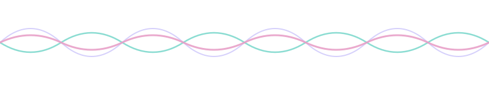
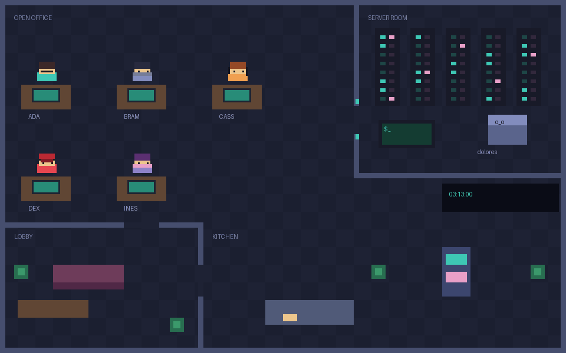
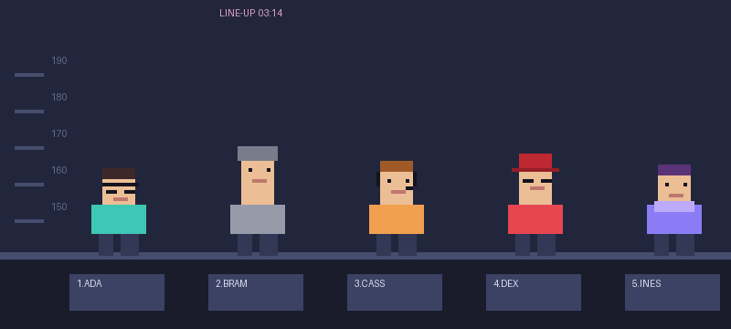

<p align="center">
  
</p>

<h3 align="center">four puzzles, rising difficulty</h3>

<p align="center"><sub>no prizes, no leaderboard. each answer has a SHA-256 so you can check yourself without peeking.</sub></p>

<br>

To check an answer, lowercase it and run:

```sh
printf '%s' "your answer" | shasum -a 256
```

<br>

### I. the key is in the waves

A message, enciphered the way people did before computers got involved. The key is one word, and it is hiding somewhere in this page's banner. Spaces are untouched; only letters shift.

```
xdhvr abwmmp ml i vxhzb euwxx ppdx bb uiycvil br jhzjim
```

`ff543eae77a4aa65be9ff69154dd6dda378b429f15743fc50f918d583f5ee568`

<details>
<summary>I give up</summary>

It is a Vigenère cipher. Open the banner's SVG source and read the comment: the key is `tide`. Decrypt each letter by subtracting the key letter (a=0), cycling the key over letters only. The plaintext is *every system is a story about what it refuses to forget*.

</details>

<br>

### II. a number worth counting

How many 8-digit numbers (no leading zero) have digits that sum to exactly 20 and no two neighbouring digits equal?

Answer is a plain integer.

`530f34318d653d9ecb7545c73d773ab0121c0612a58ac833abf7137a4b28a589`

<details>
<summary>I give up</summary>

**187497.** Count by dynamic programming over (position, previous digit, running sum), or just brute-force with a pruned depth-first search: both give the same number.

</details>

<br>

### III. five islanders

Everyone on the island is either a knight, who always tells the truth, or a knave, who always lies. Five of them speak.

> **A:** E is a knave.
> **B:** D and E are the same kind.
> **C:** D and E are different kinds.
> **D:** C and B are different kinds.
> **E:** B and A are the same kind.

Who is what? Answer as five letters in order A to E, `K` for knight and `N` for knave.

`ae2e5e4e4be0241bc975d77ff16af016a2d709487aecb4a5eb4e53386f7383af`

<details>
<summary>I give up</summary>

**KNKKN.** Of the 32 possible assignments exactly one is consistent with all five statements. A shortcut: B and C make opposite claims about the same pair (D, E), so exactly one of B and C is telling the truth, and so exactly one of them is a knight.

</details>

<br>

### IV. murder at the mainframe

03:14. Somebody dropped the production database. Her name was Dolores.

The cameras were down and the badge reader was offline, so what we have is a floor plan, a line-up and whatever the repository remembers. Five people were in the building. One of them did it.

<p align="center">
  
</p>

<p align="center">
  
</p>

Fair warning: the useful evidence is not on the page. Bring whatever tools you like. The answer is the culprit's first name in lowercase.

`9d0fbf9349f646f1435072f2b0212084752ef4601bd6b012fbbe61b6c5e03930`

<details>
<summary>I give up (spoilers, step by step)</summary>

1. **The GIF carries a note.** Read its comment block (`exiftool assets/floor.gif`, or `identify -format '%c' assets/floor.gif`). It is base64 and says the case file was filed and then removed, and that one frame is not like the others.
2. **History remembers.** `git log --diff-filter=D --name-only` shows a deleted `case/ledger.hex`. Read it from the commit before the deletion: `git show <commit>^:case/ledger.hex`.
3. **The ledger is single-byte XOR.** Brute-force all 256 keys with the crib `LEDGER`, or find the key in the odd frame: frame 5 of the floor GIF has a 30 ms delay where every other frame has 90 or 160. Boost its contrast (Pillow: `seek(5)`, `ImageOps.autocontrast`) near the bottom of the server room and it reads `k=3c`.
4. **The ledger holds five statements and one rule:** exactly two statements are lies, and the culprit is a liar. Try each suspect as the culprit. Only Dex gives exactly two liars, with Dex among them (Dex and Ines).
5. **Confirm with the confession.** It is a Vigenère cipher keyed with the culprit's first name. `dex` turns it into readable English, and the other four names do not.

</details>

<br>

<p align="center"><sub>the waves keep going</sub></p>
